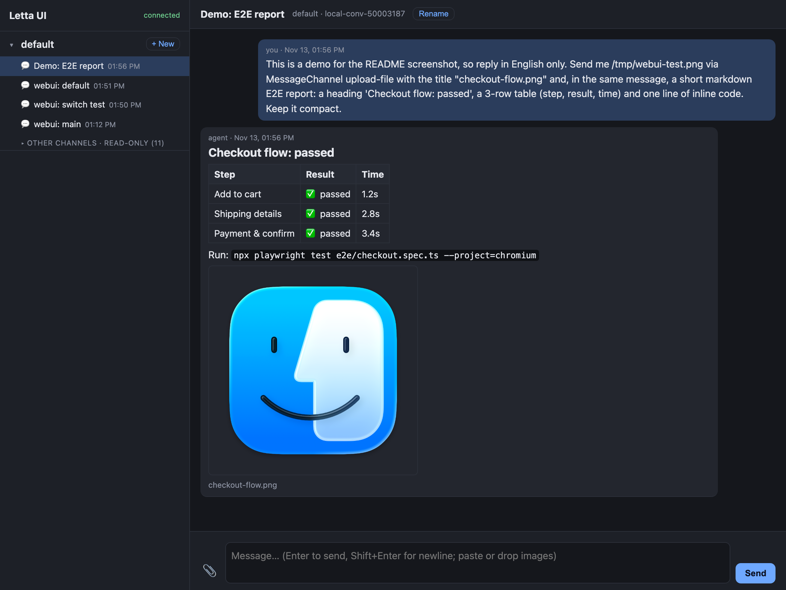

# letta-ui

A small local web chat for [Letta Code](https://github.com/letta-ai/letta-code) agents.
Agents can send you **images, videos, and files** (E2E screenshots, recordings, logs) and
**markdown**, and the page renders them inline. You get a sidebar with all your agents and
their conversations.

It is a Letta Code **user channel plugin** (`webui`), not a separate app. It runs inside
`letta server`, so the page is up exactly when the channel is up. Agents reply with the
built-in `MessageChannel` tool, so they don't need any special prompting. Letta Code itself
is not modified.



## Features

- Chat with any local Letta agent. Messages are rendered as markdown (GFM: tables,
  task lists), and code blocks get syntax highlighting and a **Copy** button.
- Agent → you: images, videos (seekable), audio, and files through `MessageChannel`
  (`action: "upload-file"`, `media: <local path>`). Consecutive screenshots are grouped
  into a **grid**, and the lightbox pages through them with ←/→. **Show in Finder** reveals
  any received file on disk.
- You → agent: attach, paste, or drag-and-drop files. Small images are also inlined for
  the model.
- While the agent works you see the current step, an expandable list of **steps** (tool
  calls), and a **Stop** button (sends Letta's `/cancel`).
- **Desktop notifications** (🔔) for replies that arrive in the background, plus unread
  counters, per-conversation "working…" dots, and an `(N)` count in the tab title.
- Sidebar: agents → conversations. **+ New** creates a conversation and binds it to the
  web chat right away, no restart needed. **Rename** and **Archive** sync back to Letta,
  so `/resume` in the TUI shows the same titles.
- **⌘K** jumps to any conversation of any agent. Typing **/** in the composer suggests
  Letta's channel commands (`/cancel`, `/model`, `/reflection`, `/status`, …).
- Conversations that belong to other channels (Slack, Telegram, …) or the TUI are listed as
  **read-only** history. You can't send into, rename, or archive them from here, so the
  web UI never drives a conversation another channel owns.
- Installable as an app (PWA): Chrome → ⋮ → *Cast, save, and share* → *Install page as
  app*, or Safari → *File → Add to Dock*. It then opens in its own window with a Dock icon.

## Requirements

- Letta Code with the **local backend** (`letta --backend local`). Tested with 0.34.59.
  User channel plugins are marked as an MVP API upstream, so re-check after Letta updates.
- macOS or Linux. No npm dependencies: the plugin uses `node:http` + Server-Sent Events
  and runs under Bun or Node ≥ 22 (it needs the global `WebSocket`), whichever runs Letta.

## Install

```sh
git clone https://github.com/nickspopov/letta-ui.git ~/projects/letta-ui
sh ~/projects/letta-ui/scripts/install.sh
```

`install.sh` writes only `~/.letta/channels/webui/`:

| File | What |
|---|---|
| `channel.json` | channel manifest (`id: webui`) |
| `plugin.mjs` | one-line stub that re-exports `src/plugin.mjs` from this repo |
| `accounts.json` | one account: port, your sender id/name, allowlist (kept if it already exists) |

Env overrides: `LETTA_UI_PORT` (default `4610`), `LETTA_UI_SENDER_ID` (default `$USER`),
`LETTA_UI_SENDER_NAME`. They only apply when `accounts.json` is created. To change them
later, edit `accounts.json` (keep `allowedUsers` in sync with `sender_id`) and restart.

Letta only discovers real directories there. A symlinked `webui/` folder is ignored, which
is why the stub exists.

## Run

```sh
cd ~                      # see note below
letta server --backend local --channels webui
open http://127.0.0.1:4610
```

Press **+ New** next to an agent and start typing.

Run it as its **own** `letta server` process. If you already run another channel server
(for example `--channels slack` for a Slack bot), leave that one alone. Both can run side
by side; each uses its own loopback port.

Start the server from a neutral directory such as `~`. `letta server` writes project
settings (`.letta/`) into its working directory.

To keep it running, use a tmux session, an alias, or a launchd agent, e.g.
`alias letta-ui='cd ~ && letta server --backend local --channels webui'`.

### Updating

`git pull`, then restart the server. Page-only changes (`public/`) need just a browser
reload.

## How it works

```
browser ──HTTP/SSE──▶ webui plugin (inside letta channel-gateway) ──▶ Letta channel registry ──▶ agent turn
   ▲                        │                                                        │
   └──── SSE events ◀───────┴──── sendMessage(text, mediaPath) ◀── MessageChannel ◀──┘
```

- **One web chat = one (agent, conversation) pair.** Each chat is a route in
  `~/.letta/channels/webui/routing.json` (`chatId` → `agentId` + `conversationId`). The
  gateway caches routes, but on a cache miss it re-reads the file, so routes added by
  **+ New** work immediately. Existing chats are never re-pointed.
- Agent and conversation lists, conversation creation and renaming, and read-only history
  come from the App Server that `letta server` starts on loopback. The plugin reads its URL
  from the gateway's `--app-server-url` argument and uses the same protocol as the official
  clients (`agent_list`, `conversation_list`, `conversation_create`, `conversation_update`,
  `conversation_messages_list`).
- Letta saves `routing.json` from its in-memory route cache, which can drop a route the
  plugin appended before Letta ever used it. The plugin keeps its own index
  (`data/chats-index.json`) and restores missing routes. To get rid of a web chat,
  **Archive** it rather than deleting its route, or the route comes back.
- Each agent's TUI `default` conversation is not returned by Letta's conversation list, so
  it doesn't appear in the read-only section.
- `MessageChannel` only exposes `media` for channels that advertise the `upload-file`
  action, so the plugin advertises `send` and `upload-file`.
- Media sent by agents is **copied** into the data dir, so the history keeps working after
  the agent deletes its temp files.

### Data

Everything stays on your machine, in `~/.letta/channels/webui/data/` (or `config.data_dir`):

```
chats/<chatId>.jsonl   web chat history (one JSON line per message)
media/                 files sent by agents (copies)
uploads/               files you sent
```

There is no automatic cleanup yet.

### Security

- Binds to `127.0.0.1` only.
- Rejects requests whose `Host` isn't `127.0.0.1:<port>`/`localhost:<port>` (DNS rebinding)
  and POSTs with a foreign `Origin` (CSRF), since a page that can post here can instruct
  your agent.
- Only senders in the account's `allowedUsers` reach the agent (`dmPolicy: allowlist`).
- Markdown is sanitized with DOMPurify, and static file paths are restricted to their
  directories.
- Tool approvals: custom channels get no channel-level permission mode, so turns run in the
  conversation's own mode. If a tool needs approval, Letta posts a text prompt into the chat
  and you answer with text. There are no approve/deny buttons yet.

## Repo layout

```
src/plugin.mjs          channel plugin: adapter, HTTP server, SSE, message store, App Server client
public/                 the page: index.html, app.js, style.css, manifest + icons
public/vendor/          marked 18.2.0 (MIT), DOMPurify 3.4.17 (Apache-2.0 / MPL-2.0),
                        highlight.js 11.12.0 (BSD-3-Clause), unmodified
scripts/install.sh      installs the channel stub into ~/.letta/channels/webui
scripts/cdp-smoke.mjs   headless-Chrome smoke check over the DevTools protocol
```

## Smoke check

```sh
"/Applications/Google Chrome.app/Contents/MacOS/Google Chrome" --headless=new \
  --remote-debugging-port=9333 --user-data-dir=/tmp/letta-ui-cdp about:blank &
bun scripts/cdp-smoke.mjs     # screenshots: /tmp/letta-ui-a.png, /tmp/letta-ui-b.png
```

## Uninstall

Stop the server, then `rm -rf ~/.letta/channels/webui` (this also deletes the web chat
history and media). The Letta conversations themselves stay. Delete them, or not, from the
TUI.

## License

MIT, see [LICENSE](LICENSE). Vendored libraries keep their own licenses (headers in the
files).
